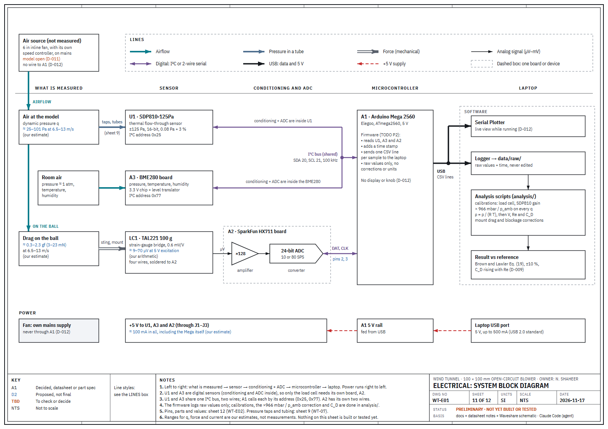
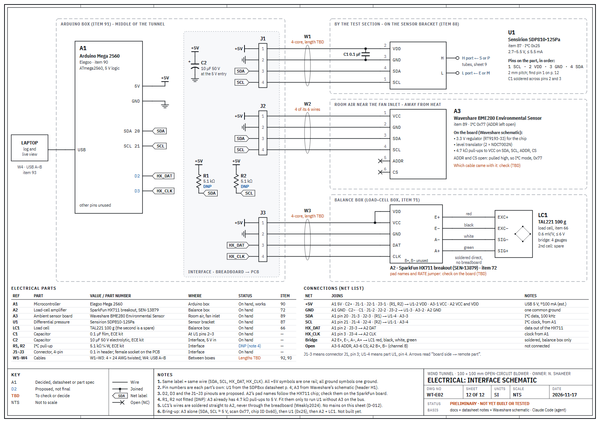

# Sensor circuit walk-through

**Status: In progress.** The breadboard's power wiring passed its meter checks on 2026-11-18. No sensor has been connected
or tested yet, so the sensor steps are still Planned (written 2026-11-17, corrected 2026-11-18 from the delivered parts).
Numbers marked *estimate* are our arithmetic, not measurements. When a step is built and tested, record the result with its date in
[experimental_setup.md](experimental_setup.md) and update this page.

**Who this is for:** anyone building this tunnel's electronics with no electronics background. It explains *why* the
circuit is the way it is (which wire goes where, and how the Arduino pins were chosen) so you can build it, check it and
change it with confidence.

**The drawings:** sheet 11 (block diagram) and sheet 12 (schematic) of the [drawing package](drawings/README.md).
The pictures below are snapshots of revision D; the drawing package is the master copy. If they ever disagree, the
drawing package wins, with one known exception: sheet 12 shows the HX711 chip's names (E+, E−, A−, A+), while the
delivered board labels those pads by wire colour (Section 4).

Contents:

1. [What the circuit does](#1-what-the-circuit-does)
2. [Ideas you need first](#2-ideas-you-need-first)
3. [How the wiring was decided](#3-how-the-wiring-was-decided)
4. [Reading the schematic](#4-reading-the-schematic)
5. [Power](#5-power)
6. [Building it on the breadboard](#6-building-it-on-the-breadboard)
7. [From breadboard to PCB](#7-from-breadboard-to-pcb)
8. [Check yourself](#8-check-yourself)
9. [Where to learn more](#9-where-to-learn-more)
10. [Open items](#10-open-items)
11. [Photos](#11-photos)

## 1. What the circuit does

The tunnel needs three measurements, many times a second:

| Quantity | Why it is needed | Sensor | Reaches the Arduino as |
|---|---|---|---|
| Dynamic pressure *q* (Pa) | Airspeed, and the *q* in C_D = F / (q·A) | Sensirion SDP810-125Pa (**U1**) | A number, over I²C |
| Drag force *F* (N) | The *F* in C_D | TAL221 100 g load cell (**LC1**) + SparkFun HX711 board (**A2**) | A number, over the HX711's two wires |
| Room pressure, temperature, humidity | Air density (for speed and Reynolds number) and the SDP810's ×966 mbar / p_amb correction | Waveshare BME280 board (**A3**) | A number, over I²C |

The Arduino Mega (**A1**) collects the three numbers, adds a time stamp and sends one line of text per sample to the
laptop over USB. The laptop shows a live plot and saves the log. **All the maths happens afterwards** in analysis
scripts: the Arduino only records raw values (project rule, [CLAUDE.md](../CLAUDE.md)).



Read the block diagram left to right: *what is measured* → *sensor* → *conditioning and ADC* → *microcontroller* →
*laptop*. The line style tells you what travels along it (air, pressure in a tube, force, an analog voltage, digital
data, USB). Power travels the other way, from the laptop to the sensors (bottom row).

## 2. Ideas you need first

### Voltage, current and resistance

- **Voltage** (volts, V) is the "push" between two points, like water pressure.
- **Current** (amps, A; 1 mA = 0.001 A) is how much charge flows, like a flow rate.
- **Resistance** (ohms, Ω) is how hard it is for current to flow.
- **Ohm's law** ties them together: V = I × R. Example from this circuit: the load cell measures about 1,090 Ω between
  its red and black wires, so 5 V across it drives I = 5 / 1090 ≈ 4.6 mA.

### Ground

A voltage is always measured *from* somewhere. **Ground (GND)** is the shared zero that every part measures from. If a
sensor's ground is not joined to the Arduino's ground, its signals mean nothing to the Arduino. **Rule: every part's GND
is joined into one common ground.**

### Power pins and signal pins

Every module has three kinds of pins: **power in** (labelled VCC, VDD or 5V), **ground** (GND), and **signal** pins that
carry information. The maker's datasheet or pinout tells you which is which and what voltage the power pin accepts.

### Analog and digital

- An **analog** signal is a voltage that varies smoothly. The load cell's output is analog, and tiny: about 30 millionths
  of a volt per gram at 5 V (estimate, from its 0.6 mV/V rating).
- A **digital** signal is only ever "low" (0 V) or "high" (5 V here). Numbers are sent as a sequence of lows and highs
  (bits).
- An **ADC** (analog-to-digital converter) turns an analog voltage into a number. The SDP810 and the BME280 have their
  ADCs built in, so they send numbers. The load cell has none, which is why it needs the HX711 board: an amplifier (×128)
  followed by a 24-bit ADC.

### How the parts talk: buses

- **I²C** ("I-squared-C", also called TWI) is a pair of wires shared by several parts: **SDA** (data) and **SCL**
  (clock). Each part has an **address**, like a house number on one street, and the Arduino starts every conversation
  by calling an address. Here the SDP810 is **0x25** and the BME280 is **0x77** ("0x" means the number is written in
  hexadecimal). Two parts with the same address cannot share a bus.
- **The HX711's two wires** (DAT and CLK) look similar but are *not* I²C. The Arduino sends clock pulses on CLK and the
  HX711 answers one bit per pulse on DAT: 25 pulses read one channel-A value at gain 128. Only one device uses these
  wires, so they can go on any two free pins.
- **USB serial** is how the Arduino sends lines of text to the laptop. Inside the Mega, pins 0 and 1 are wired to its
  USB chip, so nothing else should use them.

### Logic levels: 5 V and 3.3 V parts

The Mega's signals swing between 0 and **5 V**. Many modern chips run at **3.3 V**: a 5 V signal can damage them, and
their 3.3 V signals may be too weak for a 5 V board to read reliably. The fix is a **level translator**, a small circuit
that converts between the two. The BME280 chip is a 3.3 V part, so the Waveshare board has a 3.3 V regulator and a level
translator on it; the SDP810 is happy at 5 V and needs neither.

### Two small helper parts

- **Pull-up resistor.** On I²C, a part can only pull a wire *down* to 0 V; it never drives it high. A resistor from the
  wire to +5 V pulls it back *up* whenever nobody is pulling down. Every I²C bus needs one pair (one on SDA, one on SCL).
- **Decoupling capacitor.** A capacitor stores a little charge. Placed right at a chip's power pins, it supplies the
  quick bursts of current the chip draws, so the supply voltage stays smooth. Typical value 0.1 µF.

## 3. How the wiring was decided

The same six steps wire any sensor module to an Arduino. Here they are, worked on this circuit.

**Step 1: find what each part needs.** From the datasheets: SDP810 2.7–5.5 V; HX711 2.6–5.5 V; Waveshare BME280 board
3.3 V or 5 V. All accept 5 V, so **every power pin goes to the Mega's 5V pin**.

**Step 2: join all grounds.** **Every GND pin goes to the Mega's GND** (Section 2, Ground).

**Step 3: the signal type decides the Arduino pin.**

| Signal type | Which Arduino pins | In this circuit |
|---|---|---|
| I²C | **Fixed by the chip's hardware.** On the Mega: pin **20 = SDA**, pin **21 = SCL** (on R3 boards, also the two pins next to AREF, joined to the same lines) | SDP810 and BME280 both on 20/21, told apart by address (0x25, 0x77) |
| A simple digital link, driven by code | **Any free digital pin** | HX711 DAT → pin **2**, CLK → pin **3** |
| Analog (a varying voltage) | Analog inputs A0–A15 | None: every sensor here sends numbers |

Why pins 2 and 3? They have no special job. The pins to avoid for a plain digital link are:

- **0 and 1**: USB serial to the laptop;
- **13**: the on-board LED;
- **20 and 21**: I²C;
- **50–53**: SPI, another bus.

Every pin's special jobs are on the Mega's **pinout diagram** (Arduino's official "Arduino Mega 2560 Rev3" page has the
PDF). Choosing pins is mostly a matter of reading it and staying off the pins that already have a job.

**Step 4: check the logic levels.** The Mega is a 5 V board. The SDP810 runs at 5 V; the BME280 board has its own level
translator. **Nothing extra is needed**, but the first bench test checks the translator (Section 6, Step 1).

**Step 5: add the helper parts.**

- **I²C pull-ups:** the Waveshare board already has 4.7 kΩ pull-ups to 5 V on SDA and SCL (Waveshare's schematic), so
  the bus has them whenever the BME280 is connected. R1 and R2 (5.1 kΩ, from the ECE kit) are drawn but **not fitted**
  ("DNP", do not place); fit them only to run the SDP810 with the BME280 unplugged.
- **C1, 0.1 µF, soldered right across the SDP810's VDD and GND pins.** It is a bare sensor with no board of its own;
  the HX711 and BME280 boards already carry their own capacitors.
- **C2, 10 µF**, where 5 V enters the breadboard: a bigger reservoir for the whole circuit. It is an electrolytic
  capacitor, which has a **+ and a − leg: + goes to 5 V**. Reversed, it can fail.

**Step 6: write it down, then build one part at a time.** Writing it down is what the schematic and its net list are
(Section 4). Building one part at a time means that when something does not work, you know which part to look at
(Section 6).

That is the whole design. There is no amplifier or other analog circuit to design, because every sensor either sends
numbers itself or comes on a board (the HX711) that does it.

## 4. Reading the schematic



### Symbols and labels

| You see | It means |
|---|---|
| **A1, A2, A3** | Assemblies: ready-made boards (Arduino, HX711 board, BME280 board) |
| **U1** | A single component (the SDP810 sensor) |
| **LC1** | The load cell |
| **C1, C2 / R1, R2** | Capacitors / resistors |
| **J1–J3** | Connectors on the interface (where the sensor cables plug in) |
| **W1–W4** | Cables (wires) between the boxes |
| Small number beside a pin | The pin number *on that part* |
| Text inside a box at a pin | The pin's name (VDD, SDA, CLK…) |
| Flag shape with a name (SDA, HX_DAT) | A **net label**: every wire carrying the same label is connected, even where no line is drawn |
| T-shape marked +5V | The +5 V supply. Every +5V symbol is the same wire |
| Three shrinking bars | Ground. Every ground symbol is the same wire |
| Dot where lines meet | Joined. Lines that cross without a dot are *not* joined |
| × at the end of a pin | Not connected: leave the pin open |
| DNP | Do not place: the part is planned but not fitted |
| Black / blue / orange text | Decided or from a datasheet / proposed / still to check (TBD) |

**Important: symbols are drawn by function, not by the physical pin order.** The SDP810's pins are drawn VDD, GND,
SDA, SCL so the wires run straight, but on the real part the order is **1 SCL, 2 VDD, 3 GND, 4 SDA** (datasheet p. 4).
Always wire by the pin *numbers and names*, never by the position on the drawing.

### Part by part

- **A1, Arduino Mega 2560 (Elegoo).** Uses only 5V, GND, 20 (SDA), 21 (SCL), 2 and 3, plus the USB socket to the laptop.
- **A3, Waveshare BME280 board.** Its 6-pin header is 1 VCC, 2 GND, 3 SDA, 4 SCL, 5 ADDR, 6 CS (Waveshare's
  schematic). Leave **ADDR and CS unconnected**: the board pulls both high, which selects I²C mode at address 0x77.
  Grounding ADDR would change the address to 0x76. The delivered cable ends in six **female** sockets, which cannot plug
  straight into a breadboard or the Mega: press a male header into the breadboard and plug them onto it. By their order
  at the plug, the wires are red VCC, black GND, blue SDA, yellow SCL, orange ADDR and green CS (inferred; Section 6,
  step 1 checks what it can).
- **U1, SDP810-125Pa.** Four pins at 2 mm spacing, too close for a breadboard. Solder four thin wires straight to the
  pins (a quick joint, no flux near the two pressure ports) and solder **C1** across pins 2 (VDD) and 3 (GND), which
  sit next to each other. A female 2 mm plug is being considered instead (Section 10); C1 would then go at the breadboard
  end. Its two barbs take the pressure tubes (sheet 9). **Looking straight at the pins, with the moulded SENSIRION
  upright, they run SDA, GND, VDD, SCL from left to right, with a small "1" by SCL** (datasheet p. 4, bottom view). The
  p. 12 drawing is seen from the other side, so its order runs the opposite way. Mixing them up swaps power and ground.
- **A2, SparkFun HX711 board, and LC1, the load cell.** The load cell's four wires solder **directly** to the HX711 board,
  each to the pad of its own colour: red → **RED**, black → **BLK**, white → **WHT**, green → **GRN**. (On the schematic
  these are the chip's E+, E−, A− and A+.) **YLW** stays empty, because this cell has no yellow wire. On the other side,
  VCC and VDD both go to +5 V (one powers the analog half, one the digital half), GND to ground, DAT to pin 2, CLK to
  pin 3. Leave the two unlabelled pads near CLK and GND empty.
- **J1–J3** are the plugs where each sensor's cable meets the interface. They all use the same order: **1 = +5V,
  2 = GND, then the two signals**.

### Bench wiring table

| Mega pin | Goes to | Wire carries |
|---|---|---|
| 5V | SDP810 pin 2 (VDD), BME280 VCC, HX711 VCC **and** VDD, C2 + leg | +5 V supply |
| GND | SDP810 pin 3 (GND), BME280 GND, HX711 GND, C2 − leg | Ground |
| 20 (SDA) | SDP810 pin 4 (SDA), BME280 SDA | I²C data |
| 21 (SCL) | SDP810 pin 1 (SCL), BME280 SCL | I²C clock |
| 2 | HX711 DAT | Data from the HX711 |
| 3 | HX711 CLK | Clock from the Arduino |
| (none) | BME280 ADDR and CS | Leave open |

Use one wire colour per signal everywhere (red for +5 V and black for GND by convention; choose the other four).

## 5. Power

**The laptop is the power supply.** USB gives 5 V; the Mega passes it to its 5V pin, which feeds every sensor. No
other supply is needed for the electronics. The fan has its own mains supply and never connects to the Arduino
(decision D-012).

| Part | Current (estimate) |
|---|---|
| Arduino Mega itself | about 50–80 mA (typical for the board) |
| SDP810 | up to 5.5 mA (datasheet) |
| HX711 + load cell | about 1.5 mA + 4.6 mA (datasheet; Ohm's law above) |
| BME280 board | under 1 mA |
| **Total** | **about 100 mA**, against the 500 mA a USB 2.0 port supplies |

This project's breadboard measured **4.962 V** at its rails on the laptop's USB (2026-11-18). USB voltage can sag a
little (to about 4.7 V). That does not matter much: the SDP810 and BME280 keep their own
calibration, and the HX711 measures the load cell *relative to its own supply*, so slow changes cancel.

Two things to check once it works:

- **Charger noise.** Record the load cell's noise once with the laptop on battery and once on its charger. If the
  charger makes it worse, run tests on battery.
- **Sleep.** Stop the laptop from sleeping or turning off USB during runs, or the log stops.

An external supply would only be needed for later extras (a servo, lights, a mist maker), or as a fallback: the Mega can
take 7–12 V on its barrel jack and make its own 5 V.

## 6. Building it on the breadboard

**Safety and good habits**

- Wire with the USB cable **unplugged**. Check +5V and GND twice before plugging in.
- Nothing in this circuit touches mains. Keep it that way.
- Solder with ventilation, and park the iron in its stand.
- Add **one part at a time**, and test it before adding the next.
- **Match the meter mode to the power.** Use continuity and resistance only with USB unplugged, and DC volts with USB
  plugged in. A capacitor across the supply does not make the meter keep beeping; a steady beep from + to − means a short.

**A breadboard in one sentence:** the holes in each short row of five are joined underneath, and the long rails along
the edges are joined along their length. Use one rail for +5 V and one for GND.

### Step 0: before wiring

- Do the arrival checks in [TODO.md](../TODO.md) (P2, "Arrival checks"), including the load cell's wire resistances
  (red–black about 1,090 Ω, green–white about 1,000 Ω), and record the results.
- Look beside the Mega's AREF pin for two pins labelled SDA and SCL. If they are there, it is an R3 board (this matters
  for the PCB, Section 7). This project's board has them, marked SDA1 and SCL1.
- With the Mega **unpowered**, measure the resistance from pin 20 to the 5V pin. About 10 kΩ means the board has its
  own I²C pull-ups; much higher means it has none. Either is fine; just record it.
- Wire the rails and C2, then test them before adding anything else. With USB unplugged, each + rail should beep to the
  other + rail, each − rail to the other − rail, and + to − should not keep beeping. With USB plugged in, + to − should
  read about 5 V on each side and across C2, red probe on +. This project read 4.962 V at all three (2026-11-18).

### Step 1: BME280 alone

1. With USB unplugged and the cable in the board only, measure resistance from the red wire to blue, yellow, orange and
   green: about 4.7 kΩ each. Black to blue should be far higher. (This project: 4.597–4.617 kΩ and 145.3 kΩ, 2026-11-18.)
2. Press a male header into the breadboard and plug on red, black, blue and yellow. Leave orange and green loose. Connect
   **only** red to +5 V and black to GND, and check both by continuity before powering.
3. Plug in USB. Measure blue to GND and yellow to GND with the multimeter.
   - About **5 V**: the level translator works. Continue.
   - About **3.3 V** or near 0 V: **Stop**; do not connect SDA and SCL to the Mega.
4. Unplug, connect blue (SDA) to pin 20 and yellow (SCL) to pin 21, plug in, and run an **I²C scanner** sketch (a short
   program that calls every address and lists the ones that answer). Pass: it finds **0x77**. If it finds nothing, try
   swapping blue and yellow.
5. Read the chip-ID register (0xD0). Pass: **0x60**, a real BME280. (0x58 would mean a BMP280, which has no humidity.)
6. Breathe on it: humidity should jump. Hold a fingertip on it: temperature should rise. A test must show a change you
   caused.

### Step 2: add the SDP810

1. Solder the four wires and C1 (Section 4), or fit the chosen plug. Find pin 1 from the **pin side**, using the datasheet's
   p. 4 bottom view, **before** connecting anything, and confirm each wire to its pin by continuity.
2. Connect it to 5V, GND, 20 and 21 alongside the BME280. Pass: the scanner finds **0x25 and 0x77**.
3. Start continuous measurement (command 0x3615) and read it; 240 counts = 1 Pa for this part.
4. With both ports joined by a short tube (or capped), the reading should sit within about 0.1 Pa of zero. Blow gently
   into a tube on the High port: the reading goes positive. On the Low port: negative.

### Step 3: add the HX711 and load cell

1. Solder the load cell's four wires to the HX711 board (colours in Section 4). Solder a header strip on the board's
   other side so it plugs into the breadboard.
2. Connect VCC and VDD to 5V, GND to GND, DAT to pin 2, CLK to pin 3.
3. Hold one end of the load cell firmly (clamp it gently or screw it to a block) and leave the other end free.
4. Read raw counts. Pass: steady with nothing on it. Then set a coin on the free end (a US penny is 2.5 g): the
   counts change, and return when it is removed.
   - **Do not press it with a finger.** The cell is rated 100 g and safe only to 150 g; a firm press is far more.
5. Measure the voltage between the RED and BLK pads (the excitation, E+ and E−) and record it.

### Step 4: everything together

One sketch reads all three and sends one CSV line per sample. Pass: every value responds to a change you cause, and the
sample rate stays steady over 10 minutes (TODO P2, "Data-logging firmware").

**Record every result with its date** in [experimental_setup.md](experimental_setup.md). A part counts as *Verified* only
once its test has passed and been recorded.

## 7. From breadboard to PCB

The breadboard measures just as well as a PCB would. The PCB makes the circuit **reliable** (no jumper wires to wiggle
loose mid-run), **tidy** inside the printed Arduino box, and it is a skill worth learning. Order: **breadboard first;
PCB once the breadboard works.** Electrically the PCB is the *same circuit*, with copper traces instead of jumper wires,
so if the breadboard works, the PCB will too.

```text
        cable to SDP810   cable to BME280   cable to HX711
              │                 │                 │
   ┌──────────J1────────────────J2────────────────J3──────┐
   │   THE PCB ("shield"): 3 connectors, C2, R1/R2 pads,  │
   │   copper traces instead of jumper wires              │
   └────┬─────────────────────────────────────────────┬───┘
        │  pins underneath plug into the Mega's sockets │
   ┌────┴─────────────────────────────────────────────┴───┐
   │   ARDUINO MEGA (unchanged; USB to the laptop)        │
   └──────────────────────────────────────────────────────┘
```

- **The Mega is not built into the PCB.** The PCB is a **shield**: it plugs on top of the Mega. The sensors are not on
  it either; they stay in their places (balance box, sensor bracket, room air) and plug in by cable.
- **On the shield:** pins underneath into the Mega's 5V, GND, SDA/SCL, 2 and 3 (full header rows hold it firmly); three
  4-pin connectors J1–J3; C2; pads for R1 and R2, left empty. No chips are needed: everything runs at 5 V, the BME280
  board has its own level translator and USB supplies the power.
- **Size:** on an R3 board, SDA and SCL are also next to AREF, so the shield only has to cover the Uno-sized end of the
  Mega (about 69 × 53 mm) instead of its full length.
- **Connectors:** plain 0.1 in pins with Dupont jumpers are fine on the bench. For real runs, **locking 4-pin plugs**
  (the white Grove/JST style) cannot wiggle loose or go in backwards, and ready-made cables need no crimping tool.
  Choose when designing the shield.
- **Optional second board:** a thumbnail-sized carrier for the SDP810 (the sensor, C1, a 4-pin connector and two screw
  holes) would solve its awkward 2 mm pins and its mounting at once, in the same order as the shield.

**The steps in a PCB program** (KiCad is recommended, see [Open items](#10-open-items)):

1. **Schematic:** draw sheet 12.
2. **Footprints:** choose each part's physical shape (0.1 in header pins, the capacitor's lead spacing).
3. **Layout:** board outline matching the Mega, connectors at the edge, then draw the traces.
4. **Design rule check:** the program flags traces too close together and unconnected pins.
5. **Export the Gerber files** and upload them to a board maker (JLCPCB, PCBWay, OSH Park). Small boards usually cost a
   few dollars for five, plus shipping (check current prices).
6. **Solder:** every part is through-hole (leads through holes), the easiest kind to hand-solder.

## 8. Check yourself

Try to answer each question before opening the answer.

<details><summary>1. Why do all the parts share GND?</summary>

Voltages are measured from a reference. Ground is the shared zero; without it the Arduino cannot tell what a sensor's
"high" or "low" means.
</details>

<details><summary>2. How does the Arduino tell the SDP810 and the BME280 apart on the same two wires?</summary>

By address. Each I²C part answers only to its own address: 0x25 for the SDP810, 0x77 for the BME280.
</details>

<details><summary>3. Why are the HX711's wires on pins 2 and 3, not 0 and 1?</summary>

Pins 0 and 1 carry the USB serial link to the laptop. Pins 2 and 3 have no special job, and the HX711's simple
two-wire link works on any free digital pins.
</details>

<details><summary>4. What does a pull-up resistor do, and why are R1 and R2 not fitted?</summary>

I²C parts can only pull the wires down to 0 V; the pull-up brings them back to 5 V. The BME280 board already has 4.7 kΩ
pull-ups on SDA and SCL, so extra ones are only needed if the SDP810 runs without the BME280.
</details>

<details><summary>5. Why is C1 soldered right at the SDP810's pins?</summary>

It supplies the sensor's quick bursts of current from right next to it, keeping its supply smooth. Far away, the wire in
between would defeat it. The other two sensors are on boards that already have their own capacitors.
</details>

<details><summary>6. Why must the load-cell wires never go through the breadboard?</summary>

The load cell's signal is only millionths of a volt. Loose breadboard contacts change their resistance when touched or
warmed, by enough to swamp it. Soldered joints stay put (the lesson from the Weakly2024 balance paper).
</details>

## 9. Where to learn more

Learn each idea just before you need it.

| When | Read or watch |
|---|---|
| Before wiring anything (about 3–5 h) | SparkFun Learn (learn.sparkfun.com): "Voltage, Current, Resistance, and Ohm's Law", "How to Use a Breadboard", "How to Read a Schematic", "How to Use a Multimeter". The Arduino Mega 2560 Rev3 page and pinout PDF (docs.arduino.cc): print the pinout |
| Step 1, BME280 | SparkFun: "I2C", "Pull-up Resistors", "Logic Levels" |
| Step 2, SDP810 | Reading a datasheet's pin table (the [SDP8xx notes](../resources/notes/SDP8xx.md)); SparkFun "How to Solder: Through-Hole Soldering" or Adafruit's "Adafruit Guide to Excellent Soldering" |
| Step 3, HX711 and load cell | SparkFun: "Getting Started with Load Cells", "Analog vs. Digital", and its HX711 hookup guide; the [HX711](../resources/notes/HX711.md) and [TAL221](../resources/notes/TAL221.md) notes |
| The PCB | KiCad's "Getting Started" guide (docs.kicad.org); draw sheet 12 as the first project |
| A book or a video series | *Make: Electronics* by Charles Platt (hands-on, for beginners); Paul McWhorter's Arduino lessons on YouTube (slow and thorough) |

## 10. Open items

| Item | Status | Decided by |
|---|---|---|
| HX711 board pad labels | **Answered 2026-11-17:** RED, BLK, WHT, GRN, YLW; VDD, VCC, DAT, CLK, GND | Owner's photo |
| HX711 RATE jumper (10 or 80 samples/s) | To check | The back of the delivered board |
| Which cable came with the BME280 board | **Answered 2026-11-17:** 6-pin plug to six female Dupont sockets | Owner's photo |
| Which BME280 wire is which | Partly checked: red is VCC-side by resistance; the others inferred from their order | Back labels, or the I²C scan |
| How the SDP810 connects | Open: soldered wires, or a pre-crimped female JST PH 2.0 cable (fit unproven) | Owner |
| Is the Mega an R3 (SDA and SCL beside AREF)? | **Answered 2026-11-18:** yes, marked SDA1 and SCL1 | Owner's photos |
| Do the Mega's own I²C pull-ups exist? | To check | Step 0 above |
| Cable lengths W1–W3 | TBD | Box positions at sizing |
| Connector type for J1–J3 on the PCB | TBD | Shield design |
| PCB program: KiCad (recommended) or EasyEDA | Owner to choose (2026-11-17) | Owner |

## 11. Photos

Add photos as the build goes: one of each breadboard step, the solder joints on the SDP810 and the HX711, and the HX711
board's pad labels. Put them in [docs/images/](images/) named `YYYY-MM-DD_short-description.jpg`, compressed to about
2 MB or less ([data/README.md](../data/README.md)), and link them in the section they show.

So far: the [BME280 board and cable](images/2026-11-17_bme280-board-and-cable.jpg), the
[HX711 board and load cell](images/2026-11-17_hx711-board-and-tal221.jpg), the
[SDP810](images/2026-11-17_sdp810-125pa.jpg) and the first
[breadboard wiring](images/2026-11-18_breadboard-overview-2.jpg).

---

Sources: [SDP8xx](../resources/notes/SDP8xx.md), [HX711](../resources/notes/HX711.md) and
[TAL221](../resources/notes/TAL221.md) datasheet notes; [buy list](buy_list.md) §5–8; Waveshare's "BME280 Environmental
Sensor" schematic (read 2026-11-17); drawing package sheets 11 and 12 (revision D). Written by Claude Code (agent),
2026-11-17.
